# 🔄 JavaScript & TypeScript Loops Mastery Project

> **Shaping "Skills" for "Scaling" Higher...!!!**

## 📌 Project Description

This repository contains practical implementations and exercises on **Control Flow and Iteration in JavaScript and TypeScript**. 

The main objective of this project is to develop a deep conceptual and practical understanding of how different looping constructs operate, how conditions control program execution, and how to select the right loop construct (`for`, `while`, `do-while`, and combined logic) to solve computational problems.

The project is categorized into **4 dedicated modules**:
- **While Loop (`while-loop/`)**
- **Do-While Loop (`do-while/`)**
- **For Loop (`for-loop/`)**
- **Mixed & Nested Loops (`mix-loop/`)**

Each exercise is implemented with clean code practices, dual-typed sources (`.ts` and `.js`), and verified with terminal/browser console execution outputs.

---

## 🎯 Objectives

- Master iteration mechanics and entry-controlled vs exit-controlled loops.
- Understand state initialization, termination conditions, and step updates.
- Work with both **JavaScript (ES6+)** and **TypeScript** type systems.
- Build pattern generation, numeric processing, and conditional filtering algorithms.
- Prevent infinite execution loops through proper iteration safeguards.
- Gain hands-on debugging skills using console traces and browser UI rendering.

---

## 🛠️ Technology Used

- **Languages:** JavaScript (ES6+), TypeScript
- **Runtime:** Node.js / Browser Console / Modern Web Browsers
- **Tools:** Visual Studio Code, Git, GitHub
- **Techniques:** Dynamic conditions, accumulator patterns, nested loops, break/continue controls

---

# 📂 Project Structure

```text
JavaScript-project-2/
│
├── while-loop/
│   ├── program-1.ts / .js
│   ├── program-2.ts / .js
│   ├── program-3.html / .ts / .js
│   ├── program-4.ts / .js
│   └── program-5.ts / .js
│
├── do-while/
│   ├── program-1.ts / .js
│   ├── program-2.ts / .js
│   ├── program-3.ts / .js
│   ├── program-4.ts / .js
│   └── program-5.ts / .js
│
├── for-loop/
│   ├── program-1.ts / .js
│   ├── program-2.ts / .js
│   ├── program-3.ts / .js
│   ├── program-4.ts / .js
│   └── program-5.ts / .js
│
├── mix-loop/
│   ├── program-1.ts / .js
│   ├── program-2.ts / .js
│   ├── program-3.ts / .js
│   ├── program-4.ts / .js
│   └── program-5.html / .ts / .js
│
├── screenshots/
│   ├── while-loop/
│   ├── do-while/
│   ├── for-loop/
│   └── mix-loop/
│
└── README.md
```

---

# 📚 Module 1: While Loop (`while-loop/`)

An entry-controlled loop that evaluates conditions before the body executes. Ideal when the exact number of iterations is unknown beforehand.

---

### Program 1 — Basic Counter & Iteration
Demonstrates condition verification, increment logic, and value accumulation using standard `while` syntax.

#### Output Screenshot
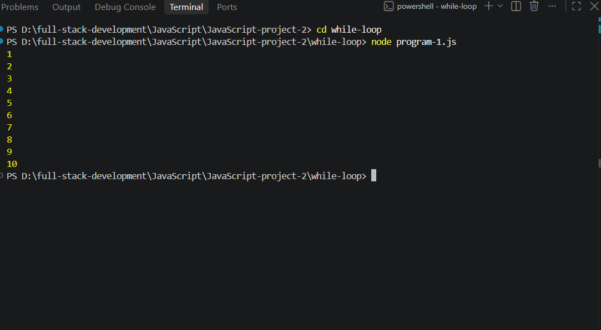

---

### Program 2 — Sequence Generation & Math Operations
Generates specific series and performs operations on sequential numerical sets.

#### Output Screenshot
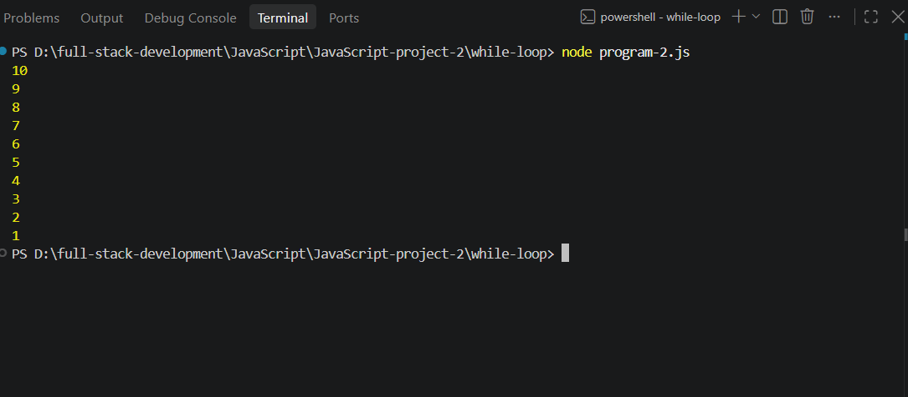

---

### Program 3 — Interactive / DOM Loop Implementation
Demonstrates iterative logic integrated with web presentation, using dynamic DOM manipulation.

#### Output Screenshot (Part 1)
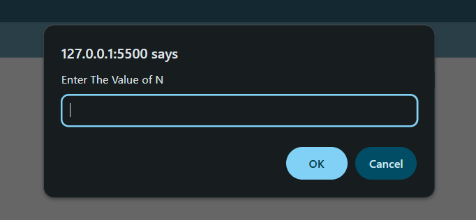

#### Output Screenshot (Part 2)


---

### Program 4 — Dynamic Step and Decrement Processing
Demonstrates countdown patterns, dynamic decrement steps, and boundary value checking.

#### Output Screenshot
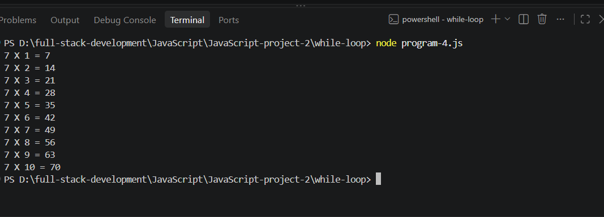

---

### Program 5 — Accumulator & Mathematical Reductions
Accumulates totals, sums, or product calculations across iterated inputs.

#### Output Screenshot
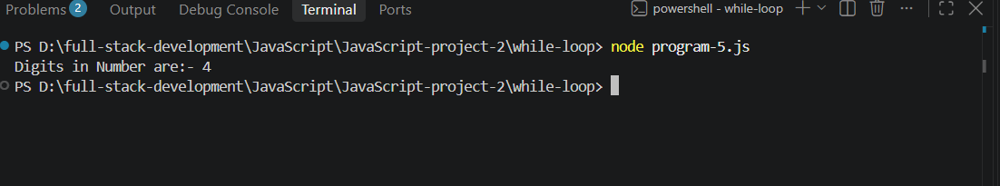

---

# 📚 Module 2: Do-While Loop (`do-while/`)

An exit-controlled loop that guarantees the code block executes at least once before checking the evaluation condition.

---

### Program 1 — Guaranteed Single-Run Execution
Demonstrates the fundamental difference between entry and exit controlled logic.

#### Output Screenshot
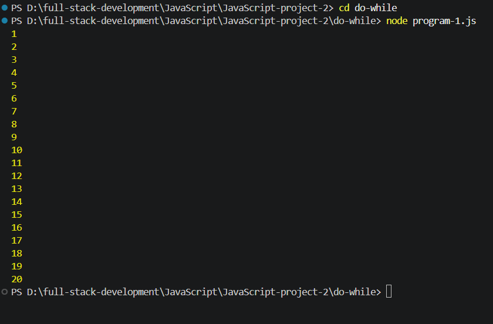

---

### Program 2 — Numeric Transformation
Applies step operations on user inputs or static counters using `do-while`.

#### Output Screenshot
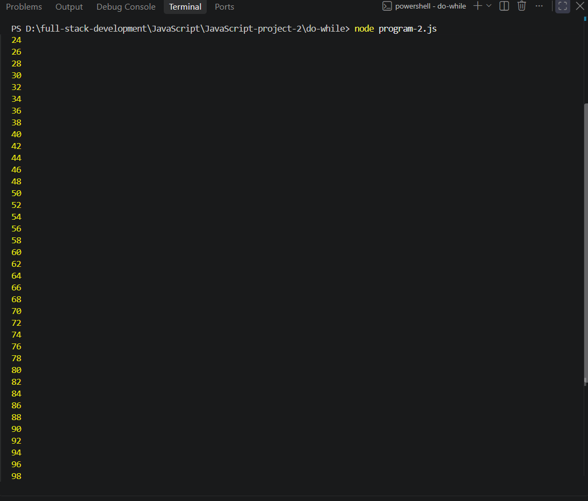

---

### Program 3 — Menu Simulation & Repeated Prompting
Simulates state transitions and repeated execution cycles until a exit criteria is met.

#### Output Screenshot
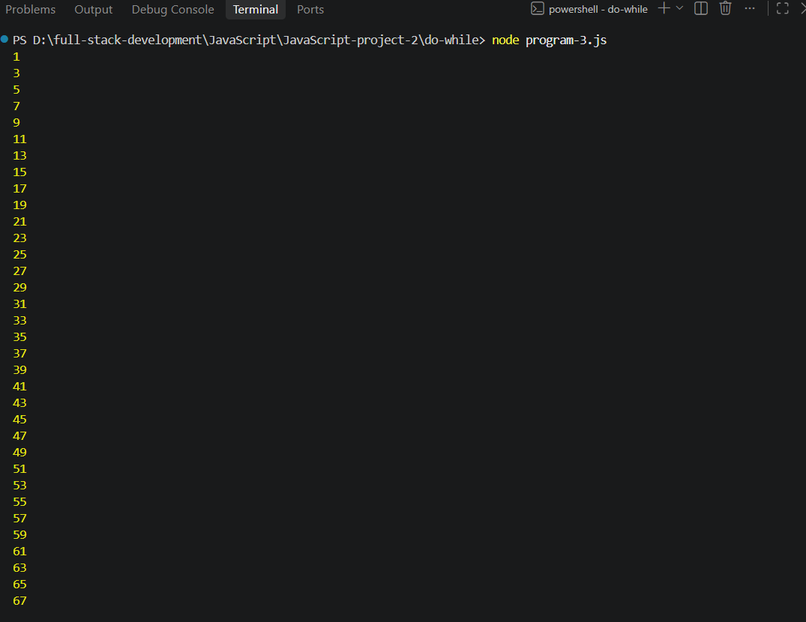

---

### Program 4 — Dynamic Increment & Validation Checking
Validates state boundaries after processing computations in the loop body.

#### Output Screenshot
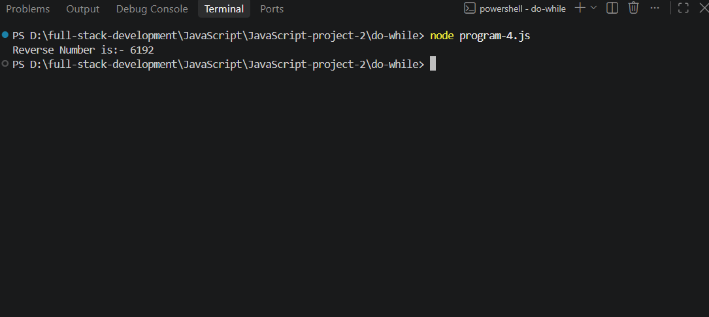

---

### Program 5 — Number Manipulation & Aggregation
Iterates over calculated states, displaying progression step-by-step.

#### Output Screenshot


---

# 📚 Module 3: For Loop (`for-loop/`)

A compact loop construct combining initialization, testing condition, and increment/decrement step in a single statement.

---

### Program 1 — Standard Iteration & Series
Iterates across continuous numerical sets and verifies execution limits.

#### Output Screenshot (Part 1)
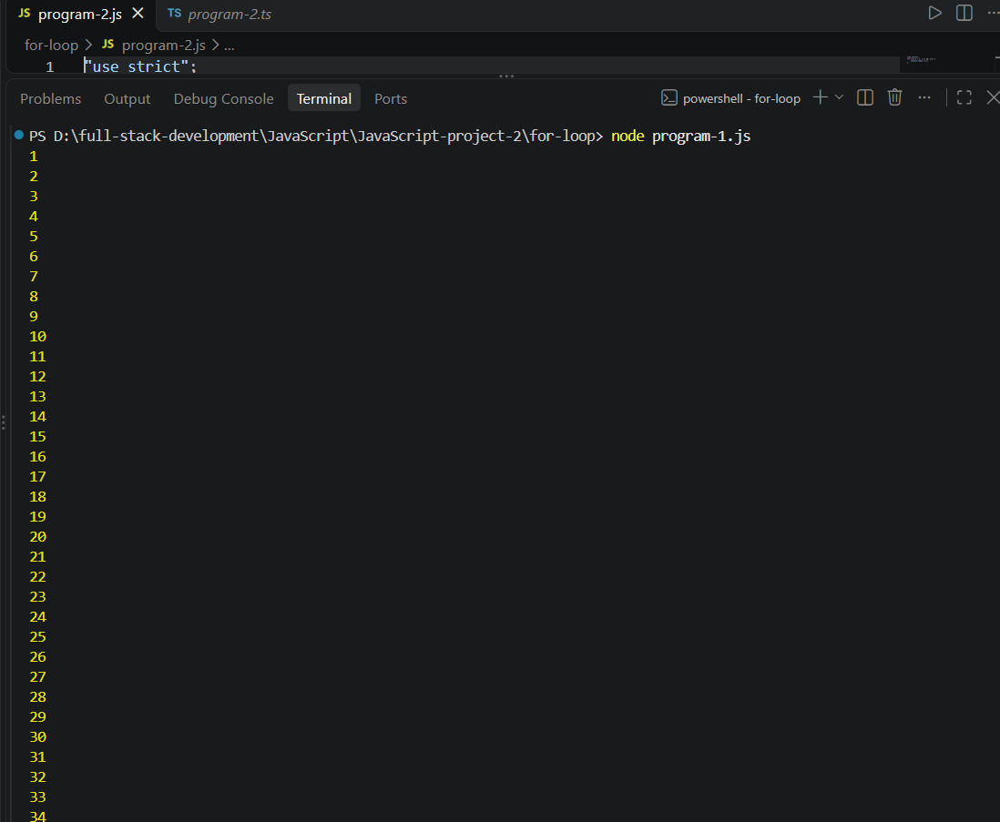

#### Output Screenshot (Part 2)
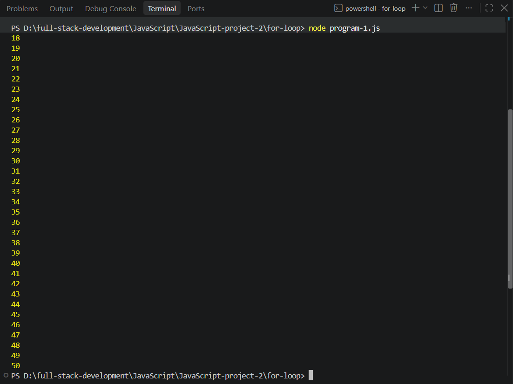

---

### Program 2 — Step Multiplications & Tables
Generates mathematical tables and custom interval steps.

#### Output Screenshot
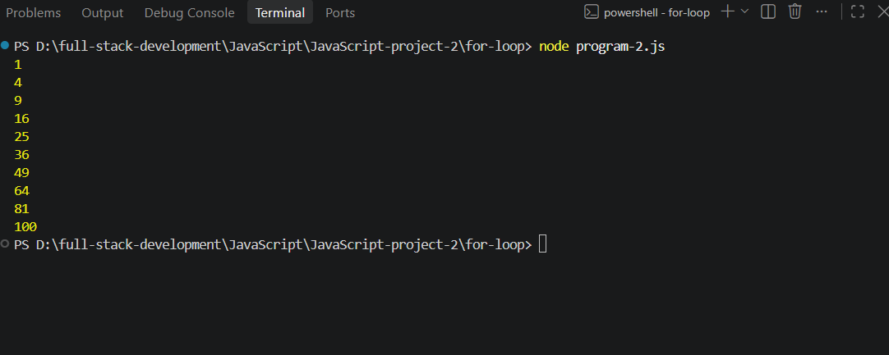

---

### Program 3 — Reverse Sequences & Conditional Filters
Iterates backwards from a high index and filters elements matching criteria (even/odd/multiples).

#### Output Screenshot
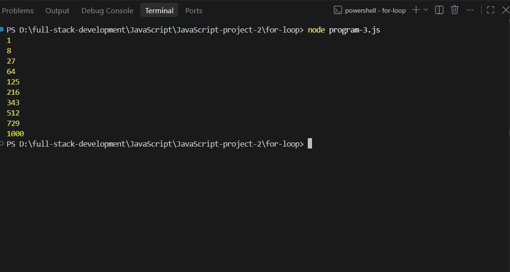

---

### Program 4 — Array & Indexed Data Iteration
Iterates through collections, accessing values via incrementing indexes.

#### Output Screenshot
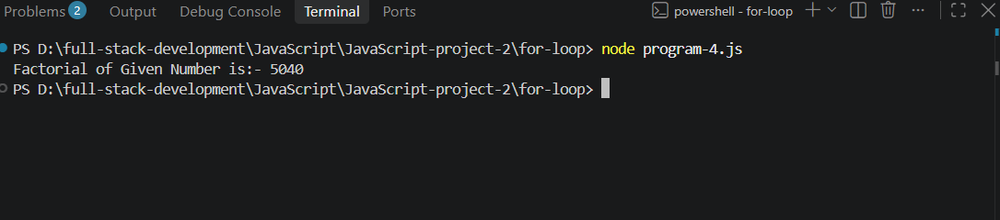

---

### Program 5 — Formula Summation & Math Calculation
Implements mathematical formulas and factorial/series sums with fixed loop boundaries.

#### Output Screenshot
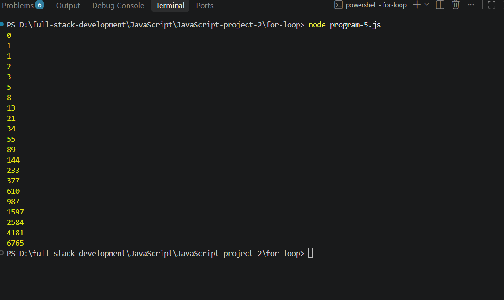

---

# 📚 Module 4: Mixed & Nested Loops (`mix-loop/`)

Covers combinations of nested loops, mixed control flows, and interactive browser output.

---

### Program 1 — Nested Pattern Generation
Uses outer and inner loops to generate structured matrix grids and geometric symbol patterns.

#### Output Screenshot
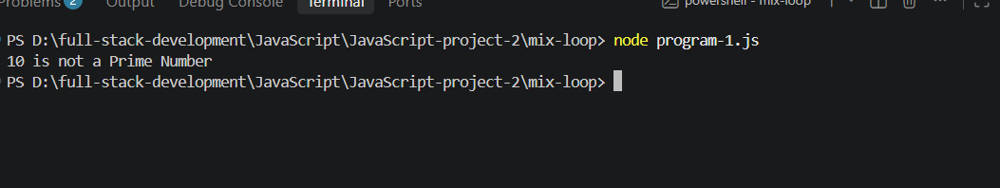

---

### Program 2 — Mixed Condition Matrix Processing
Combines multiple loop types to solve multi-step computational problems.

#### Output Screenshot
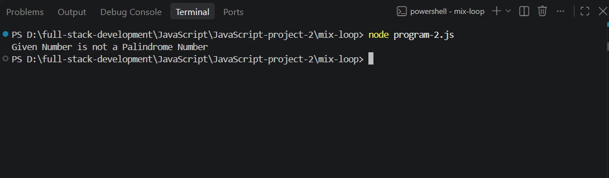

---

### Program 3 — Dynamic Nested Iteration
Processes complex ranges and hierarchical iterations with conditional branches.

#### Output Screenshot


---

### Program 4 — Multi-Stage Loop Optimization
Demonstrates early exits, break conditions, and optimized iteration strategies.

#### Output Screenshot
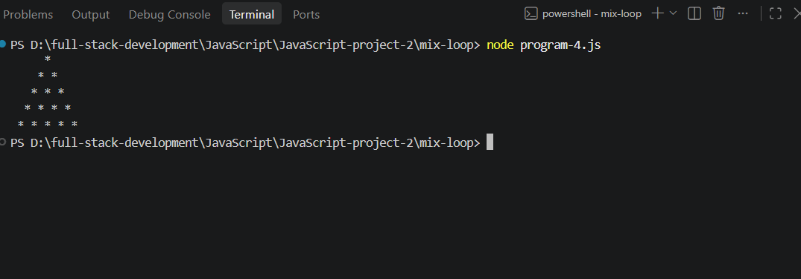

---

# 🧠 Core Concepts Mastered

| Concept | Description |
| :--- | :--- |
| **`for` Loop** | Best suited for counter-controlled loops where iteration count is predetermined. |
| **`while` Loop** | Optimal for condition-controlled loops with entry verification. |
| **`do-while` Loop** | Exit-controlled execution ensuring the code executes at least once regardless of condition. |
| **Nested Loops** | Running loops inside loops for matrices, coordinate mapping, and 2D patterns. |
| **TypeScript Types** | Strict variable typing (`number`, `string`, `boolean`) inside loop variables for safer code. |

---

# 💡 Learning Outcomes

- Gained clarity on choosing between `for`, `while`, and `do-while` loops based on use-case.
- Mastered termination conditions to prevent infinite loops and memory leaks.
- Understood index-based traversal, nested matrix generation, and accumulator patterns.
- Acquired hands-on experience compiling TypeScript into clean ES-compliant JavaScript.

---

# 📋 Project Information

- **Project:** JavaScript & TypeScript Loops Mastery (Project 2)
- **Concepts:** Control Flow, Loops, Iteration, TypeScript Typing, Algorithm Patterns
- **Primary Languages:** JavaScript, TypeScript, HTML
- **Testing Platform:** Node.js, Web Browsers, VS Code

---

# 👨‍💻 Author

**Mohammed Ali Khan**

GitHub Repository: **JavaScript-project-2**

---

## 🚀 Project Status

**Completed ✅**
